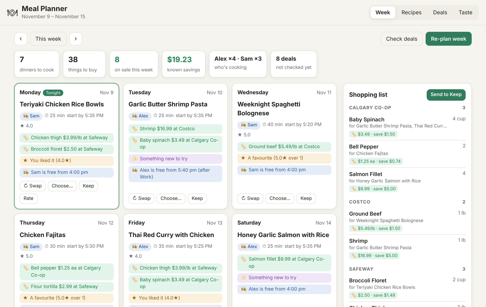

# Meal Planner

Plans the week's dinners for the house, then puts the shopping list on Google Keep.

Every week it looks at:

- **Who's free.** Everyone's Google Calendar. Each night goes to whoever has the most time
  before dinner, and the nights are shared out. A busy night gets a quick dinner. If nobody's
  free after a big batch the night before, it plans leftovers.
- **What's on sale.** This week's flyers at Safeway and Calgary Co-op (through Flipp) and
  Costco's weekly sale items (Flipp plus cocowest.ca), searched for everything your recipes use. Recipes whose main ingredients are on sale move up,
  and the list says where to buy each thing.
- **What you like.** Rate dinners 1–5 with one tap. Ratings and swaps nudge that recipe, its
  cuisine and its protein. It also avoids repeats from the last couple of weeks and doesn't
  serve the same protein two nights running.

Every pick comes with its reasons ("Chicken thigh $3.99/lb at Safeway", "A favourite (4.8★)",
"Sam is free from 4:30 pm (after Hockey)").

**No AI in the loop.** Planning, deals and learning are ordinary code with a small SQLite
database, so it costs nothing to run, gives the same answer for the same week and never forgets
what you told it. Claude can drive it through a dozen narrow MCP tools when you want to chat
("swap Tuesday for something with chicken"), and each of those is one small call.



## Try it now (made-up household)

```sh
uv sync
uv run meals demo          # http://127.0.0.1:8201
```

The demo has its own data folder (`data-demo/`), sample deals and a busy week. It never touches
Google Keep.

## Run it for real

```sh
cp planner.example.toml planner.toml     # who cooks, calendars, postal code, stores, pantry
uv run meals deals                       # check this week's flyers
uv run meals plan                        # plan the upcoming week
uv run meals serve                       # http://127.0.0.1:8200
```

On Windows, double-click `start.bat` (and `stop.bat`). Setting up calendars, Keep, the weekly
run, Claude and Daily Dashboard is in [docs/SETUP.md](docs/SETUP.md).

## What's on the page

- **Week.** Seven dinner cards: the dish, who cooks, when to start and why it was picked.
  **Swap** takes the next best option, **Choose…** lets you pick, **Keep** pins a dinner when
  you re-plan, **Rate** teaches it. Yesterday's unrated dinners ask for stars at the top.
- **Shopping list.** Added up across the week, minus the pantry, grouped by the store with the
  best deal, with known savings. **Send to Keep** previews the change first.
- **Recipes.** 31 family dinners to start with. Paste any recipe link to add it (most recipe
  sites publish schema.org recipe data, which it reads directly). **Stop suggesting** retires one.
- **Deals.** Everything on sale this week that your recipes use, plus a form for deals the
  flyers don't show, like the Costco coupon book.
- **Taste.** Favourites, what it has learned you like more or less of, and dinners to rate.

## Commands

| Command | What it does |
| --- | --- |
| `meals serve` / `meals stop` | Web page and API on port 8200 |
| `meals weekly` | Check deals, plan the upcoming week, update Keep. Schedule this. |
| `meals plan [--week DATE] [--fresh]` | Plan a week (kept dinners stay unless `--fresh`) |
| `meals show [--week DATE]` | Print the plan |
| `meals deals` | Check the flyers now |
| `meals add-deal STORE NAME [--price P --until DATE --note N]` | Save a deal you saw |
| `meals import URL` | Add a recipe from a link |
| `meals rate RECIPE_ID STARS` | Rate a recipe |
| `meals keep-sync [--dry-run]` | Put the list on Keep |
| `meals mcp` | MCP server for Claude (stdio) |
| `meals demo` | The made-up household on port 8201 |

## API

`GET /api/week?start=`, `POST /api/week/plan`, `POST /api/days/{day}/swap|lock`,
`POST /api/ratings`, `GET /api/ratings/pending`, `GET /api/preferences`, `GET|POST /api/recipes`,
`POST /api/recipes/import`, `DELETE /api/recipes/{id}`, `GET|POST /api/deals`,
`POST /api/deals/refresh`, `POST /api/keep/sync`, and **`GET /api/dashboard`**, a small, stable
summary for Daily Dashboard's Meals card. Interactive docs at `/docs`.

## Layout

- `meals/planner.py` picks the cook and the dinner for each night, with reasons.
- `meals/schedule.py` reads calendars (secret iCal addresses) and works out free time before dinner.
- `meals/deals.py` and `meals/sources/flipp.py` collect and match flyer deals.
- `meals/learn.py` turns ratings and swaps into preference weights.
- `meals/shopping.py` builds the list; `meals/keep.py` syncs it to Google Keep.
- `meals/recipes.py` is the cookbook and the link importer; `meals/ingredients.py` parses lines
  like "2 lb boneless chicken thighs, trimmed".
- `meals/service.py` is shared by `api.py` (web), `cli.py` and `mcp_server.py` (Claude).
- `web/` is the page: plain HTML, CSS and JavaScript, no build step.
- `plugin/` is a Claude plugin (MCP server + skill).
- State lives in `data/planner.db` (SQLite). It is git-ignored.

## Checks

```sh
uv run pytest
uv run ruff check meals tests && uv run ruff format --check meals tests
uv run mypy
```
